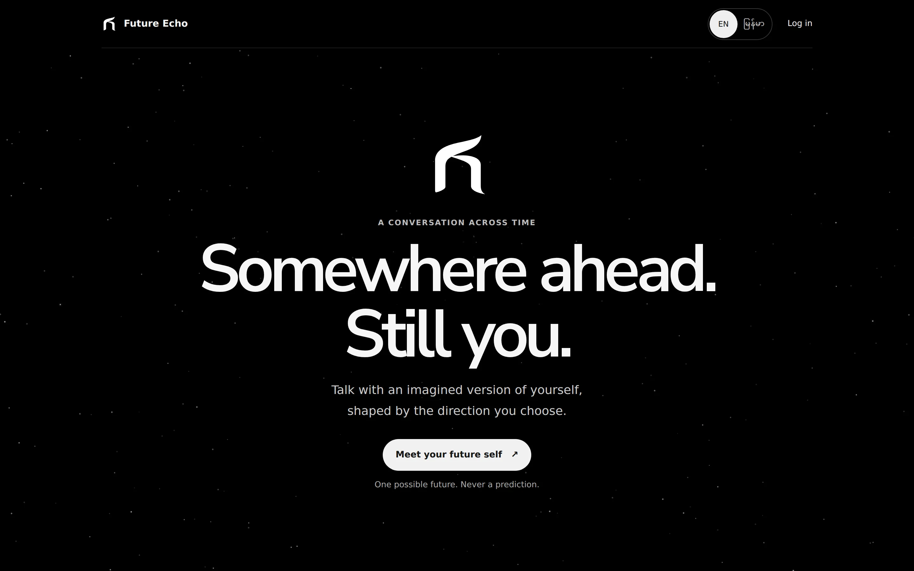
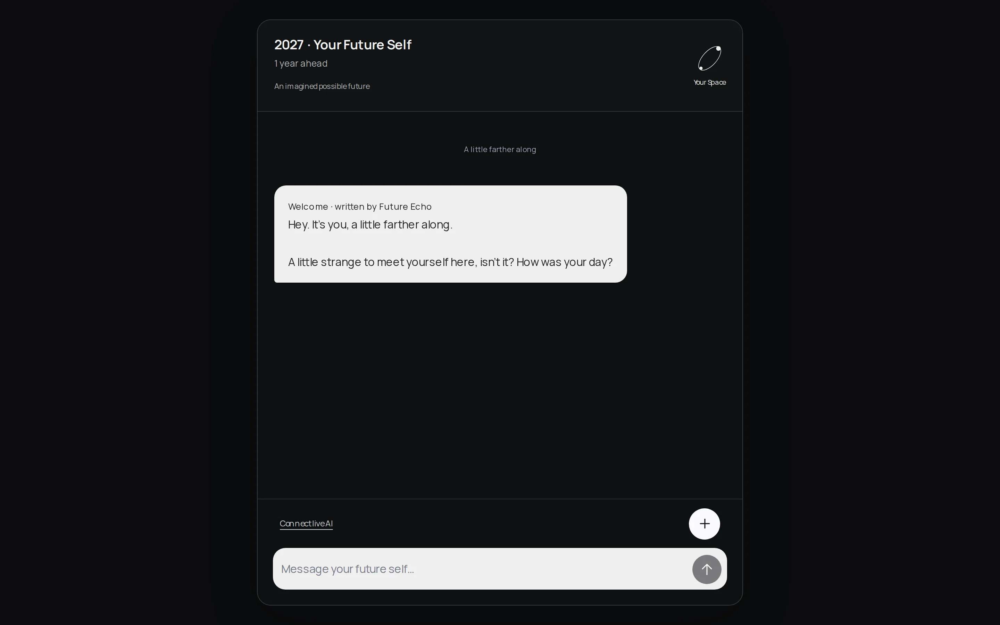

# Future Echo

**Talk with one imagined possible future version of yourself — never a prediction.**

Future Echo is a quiet, reflective app for practicing a chosen future perspective. Bring an ordinary day into conversation, hear a warm and honest reply from that imagined self, and deliberately keep only the moments you choose.

**Live demo:** [https://future-echo-sandy.vercel.app/](https://future-echo-sandy.vercel.app/)





## Why Future Echo

It is not a general chatbot, and it is not a journal:

- **A stable, user-defined perspective.** One active Future Self at a time, chosen by you, with a horizon of at least six months.
- **Deliberate memory.** Full conversation history is never used as long-term AI memory. Only moments you explicitly save become structured memory.
- **Clear authorship.** Your original words stay primary; AI interpretation is labelled, secondary, and removable; your note stays yours.

It is not prediction, therapy, or productivity tracking — no streaks, scores, or engagement loops.

## Key features

### Conversation

- Intimate messenger with distinct present-day and imagined-future message surfaces
- Warm, honest, lightly mentoring default voice — never omniscient or authoritative
- English and Myanmar interface, with replies that follow your language
- Works on-device without an account; live AI requires an explicit connection

### Save this moment

- Saving is manual, reviewable, and explicitly confirmed
- Three visible layers: original excerpt, AI interpretation, and My Note
- Redaction before confirmation; original evidence stays immutable afterwards
- Memory-use consent is separate from saving, and My Note needs its own opt-in

### Memory & journal

- Chronological Memory grouped by year and populated month; empty months stay quiet
- Tactile memory-book editor with photos, movable text, stickers, covers, paper, and note fonts
- Direct mouse, touch, and keyboard arrangement with Undo/Redo
- Local-first storage in IndexedDB, with validated JSON backup, preview, and recovery

### Accounts & direction

- Google-first sign-in and sign-up with required adult confirmation; email remains available as a fallback
- Versioned Future Self lifecycle: edit, archive, and begin again without losing the past
- A non-AI Horizon Day reflection when your chosen distance arrives — no pass/fail framing
- Your Space for direction, settings, reading size, motion preferences, and backups

### Privacy by design

- A server-side context builder sends only the current message, up to 10 recent messages, your active Future Self, and up to 3 consented moments
- Photos, drafts, layouts, interpretations, and payment data never enter model context
- Journals and backups stay on your device; signing in does not upload them
- Optional hosted replies (SEA-LION) are opt-in, consent-gated, and disclosed before connection; this is not end-to-end encryption

## Tech stack

| Layer | Choice |
| --- | --- |
| Framework | Next.js 16 (App Router), React 19, TypeScript (strict) |
| Styling | Tailwind CSS v4 with reusable CSS custom-property tokens |
| Accounts & data | Supabase (Auth + Postgres + row-level security), HttpOnly session cookies |
| AI | Provider-neutral server boundary; configuration-gated hosted replies |
| Persistence | Revision-checked IndexedDB journal; validated JSON backups |
| Hosting | Vercel |
| Tests | Node test runner (unit), Playwright (browser), isolated SQL/RLS suite |
| CI | GitHub Actions (read-only checks; no deployment) |

## Run locally

Requires **Node.js 24**. In a WSL checkout, use WSL-native Node — Windows npm cannot build the WSL path.

```bash
git clone https://github.com/tainsinmoe04/future-echo.git
cd future-echo
npm ci
npm run dev:local
```

Open [http://localhost:3000](http://localhost:3000). The product runs fully on-device with no backend configuration; account and hosted-AI features activate only when you supply your own server environment variables (see [.env.example](./.env.example)). Never commit real secrets.

### Checks

```bash
npm test          # unit tests
npm run lint      # ESLint
npm run typecheck # TypeScript
npm run build     # production build
npm run test:e2e  # browser tests (start the app first)
```

Browser tests use Playwright: install Chromium with `npx playwright install chromium`, or set `PW_CHANNEL=chrome` to use an installed Chrome. Desktop, mobile, and small-mobile viewports are configured.

## Routes

| Route | Purpose |
| --- | --- |
| `/` | Landing page and core-loop demonstration |
| `/login`, `/signup` | Google-first account entry with adult confirmation |
| `/onboarding` | Three-stage possible-future setup with horizon presets |
| `/now` | Conversation, session review, and Save Moment flow |
| `/memory` | Chronological saved moments and notes (Your Space) |
| `/future-self` | Active direction editing and archive lifecycle |
| `/api/ai` | Server-only AI boundary; inactive unless explicitly configured |

## Documentation

- [SPEC.md](./SPEC.md) — product requirements and acceptance criteria
- [LEARN.md](./LEARN.md) — durable decisions and rejected directions
- [SECURITY.md](./SECURITY.md) — security boundaries and vulnerability reporting
- [RELEASE_NOTES.md](./RELEASE_NOTES.md) — recent release details

## Status & limits

Future Echo is in active beta for adults (18+). Deliberately not yet included: password recovery, approved account-deletion flows, notifications, export/print, and a completed bilingual safety evaluation for the connected provider. Local journals and backups are unencrypted and are not cloud-synced; browser cleanup can remove them.

Read [SPEC.md](./SPEC.md) and [LEARN.md](./LEARN.md) before changing product behavior or visual direction.
